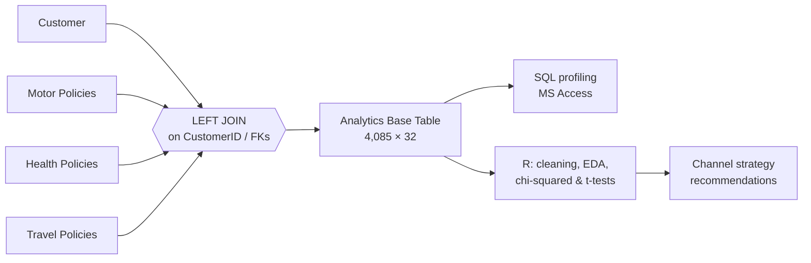
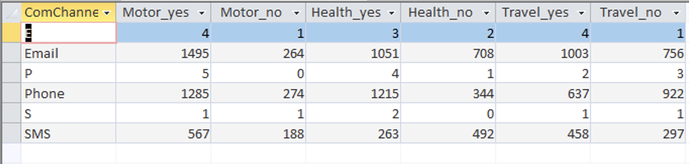
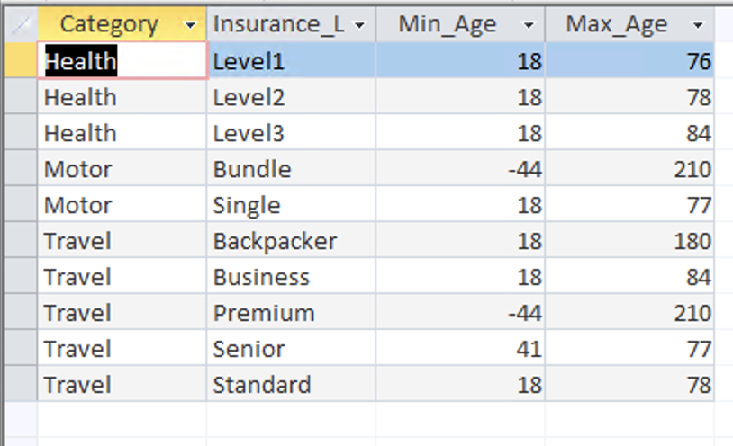
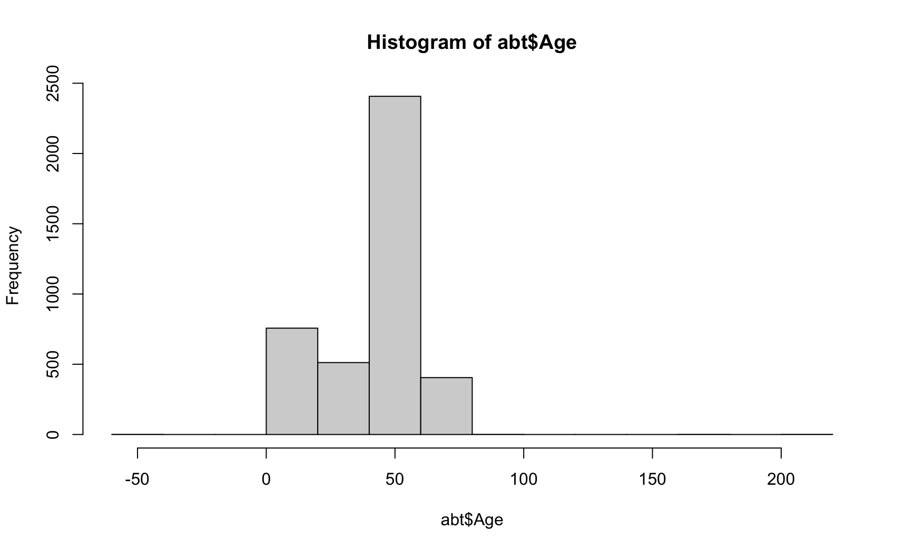
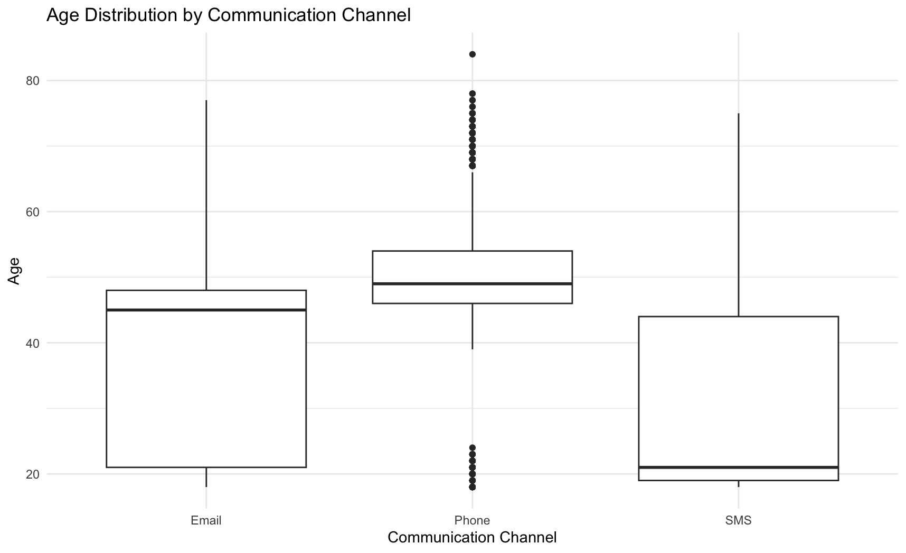
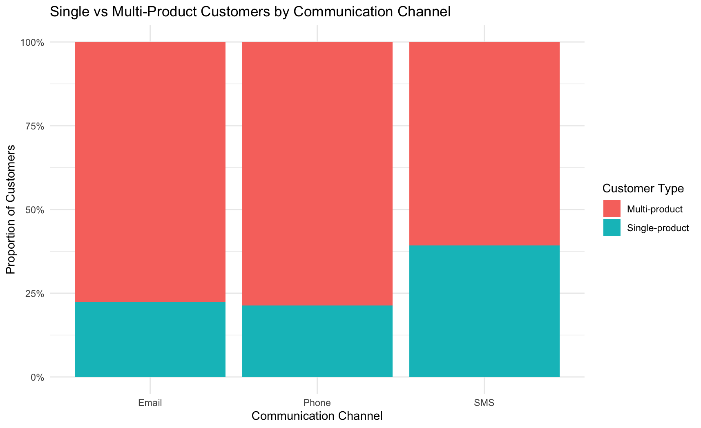
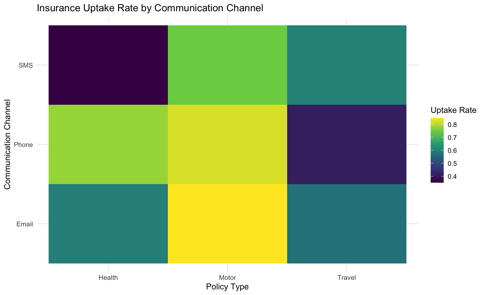
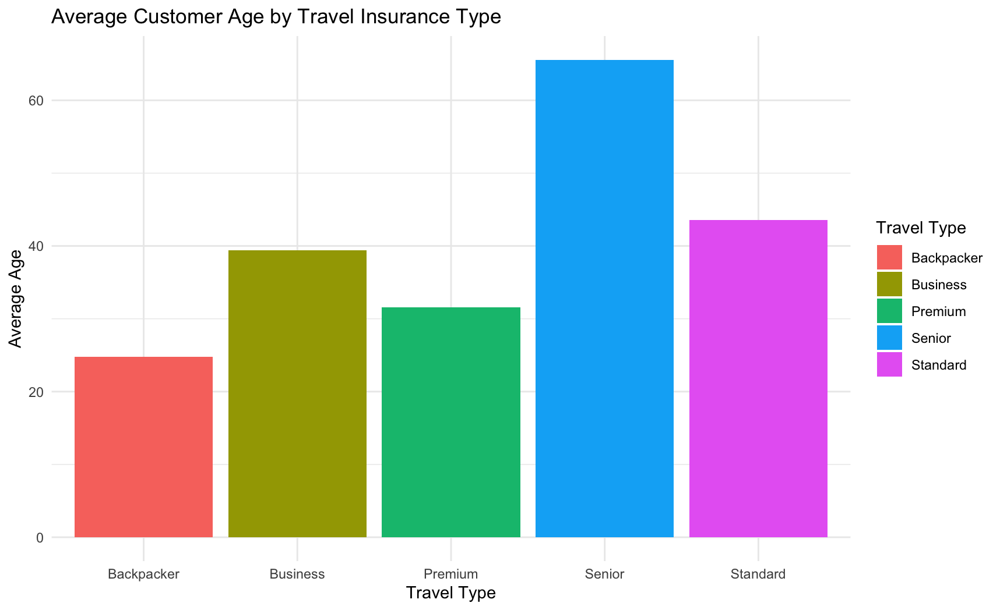
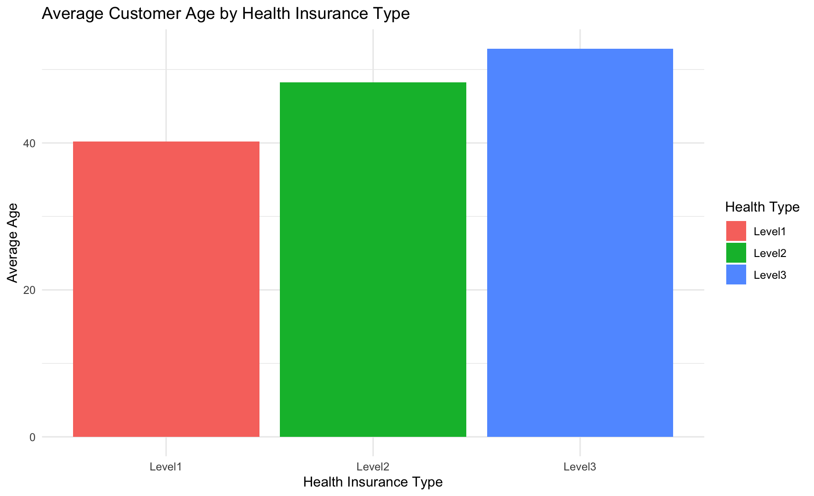

# Building a Single Customer View: Insurance Data Integration & Analytics

**MSc Business Analytics: Data Management**
**Author:** Ria Goel  ·  **Tools:** Microsoft Access (SQL) · R (tidyverse, ggplot2) · Apache Spark (big data proposal)

> An insurer stores customer, motor, health and travel data in **four separate tables**, so it has no single view of its customers. This project designs a relational database, builds an **Analytics Base Table (ABT)** with SQL, cleans the data in R, and uses the result to answer a business question: **how do customer profiles and product holdings differ by preferred communication channel, and how should marketing respond?**

---

## Key results at a glance

| | Result |
|---|---|
| **Data integration** | 4 source tables → 1 customer-level ABT (**4,085 customers × 32 variables**) using LEFT JOINs, so customers with no policy were kept |
| **Data quality issues found and fixed** | Ages from **−44 to 210**, more than 10 dependent children, duplicate channel codes (`E`/`Email`, `P`/`Phone`, `S`/`SMS`), `f`/`m` gender codes, a `"0"` card type |
| **Product mix** | Motor 3,357 · Health 2,538 · Travel 2,105 policyholders |
| **Channel × age** | SMS customers are clearly younger. Email and Phone customers are older |
| **Cross-sell** | Email and Phone customers hold more products. SMS customers are more often single-product |
| **Health uptake** | **77.9%** of Phone customers vs **34.8%** of SMS customers |
| **Statistical evidence** | Chi-squared tests show product uptake depends on channel for all three products (p < 0.001). Welch t-tests: health holders average **47.3 years** vs 31.6 for non-holders, travel holders 38.7 vs 44.2 |

---

## Business problem
Customer details, policies and claims sit in separate datasets. That makes it slow, and sometimes impossible, to answer simple questions such as *"which customers hold more than one product?"* or *"which channel reaches which customers?"* The aim was to:
1. **Integrate** the data into one reliable, customer-level table.
2. **Audit and fix** data quality before any analysis.
3. **Profile** customers by channel, product and life stage to guide targeted marketing.
4. **Recommend** a scalable big data architecture for when data volumes grow.

## Approach



### 1. Database design (Microsoft Access)
- **Customer** is the core entity, with `CustomerID` as its primary key. Each policy table is linked through a foreign key (`MotorID`, `HealthID`, `TravelID`), since a customer can hold zero, one or several products.
- **LEFT JOINs** keep every customer, including those without a given product. Inner joins would have biased the analysis towards multi-product customers.
- Policy start and end dates were **renamed by product** in the ABT to avoid naming clashes.

### 2. SQL profiling: [`code/sql_analysis_queries.sql`](code/sql_analysis_queries.sql)
Seven queries cover policy counts, holdings by channel (`SUM(IIF(...))` pivots), product mix percentages with subqueries, and average, minimum and maximum age by product using `UNION ALL`. The SQL work also **exposed the data quality problems early**:



*Raw labels `E`, `P` and `S` appear alongside `Email`, `Phone` and `SMS`.*

 

*Impossible ages, down to −44 and up to 210.*

### 3. Data cleaning in R: [`code/abt_analysis.R`](code/abt_analysis.R)
| Issue | Fix |
|---|---|
| Gender coded `f`/`m` alongside full labels | `fct_recode` to `female`/`male`, then drop unused levels |
| Channel coded `E`/`P`/`S` alongside full labels | Recode to `Email`/`Phone`/`SMS` |
| Card type `"0"` | Relabel as `"Neither"` |
| Age < 18 or > 105 | Set to missing and remove |
| More than 10 dependent children | Set to missing |
| Wrong data types | Categoricals to factors, claim dates to `Date`, claim counts to integers |
| Missing values from products a customer doesn't hold | **Kept as NA**, because they mean "no policy", not missing data |

### 4. Analysis and statistical testing
Visual EDA used ggplot2 (box plots, stacked bars, heatmaps, density plots). Formal tests followed: **chi-squared** for product uptake against channel, and **Welch two-sample t-tests** for age against product ownership. A claims-per-exposure metric flagged high-risk motor customers.

## Key findings

**Channel tracks age:** SMS reaches younger customers, while Email and Phone reach older ones.


**Email and Phone customers hold more products, which makes them the stronger cross-sell channels.**


**Uptake differs by channel and product.** Health uptake is strongest through Phone, and travel uptake is weakest through Phone.


| Uptake rate (from SQL Table 2) | Motor | Health | Travel |
|---|---|---|---|
| Email | 85.0% | 59.7% | 57.0% |
| Phone | 82.4% | **77.9%** | 40.9% |
| SMS | 75.1% | 34.8% | **60.7%** |

**Products follow life stage.** Backpacker travel policies attract the youngest customers and Senior policies the oldest. Average age rises from health Level 1 to Level 3.
 

**Statistical tests**

| Test | Result |
|---|---|
| χ² Motor uptake × channel | X² = 36.26, df = 2, p = 1.3 × 10⁻⁸ |
| χ² Health uptake × channel | X² = 404.94, df = 2, p < 2.2 × 10⁻¹⁶ |
| χ² Travel uptake × channel | X² = 117.41, df = 2, p < 2.2 × 10⁻¹⁶ |
| t-test Age × Health ownership | 47.3 (holders) vs 31.6 (non-holders), p < 2.2 × 10⁻¹⁶ |
| t-test Age × Motor ownership | 41.7 vs 39.7, p = 0.0046 |
| t-test Age × Travel ownership | 38.7 vs 44.2, p < 2.2 × 10⁻¹⁶ |

## Recommendations
1. **Match the channel to the customer:** SMS for younger customers and simple products such as travel. Phone and Email for older customers and health insurance.
2. **Use Email and Phone for cross-selling**, since their customers already hold more products.
3. **Target by life stage:** health campaigns at middle-aged and older customers (especially those with dependants), travel campaigns at younger, more mobile customers.
4. **Enrich the data** with a broader occupation classification and income information to sharpen segmentation.

## Scaling up: big data architecture proposal
For enterprise-scale volumes, the report proposes a **cloud data lake with Apache Spark**:
- It stores raw structured and semi-structured policy, claims and interaction data.
- It runs the same ABT joins and aggregations **in memory and in parallel**, using familiar SQL through Spark SQL.
- It integrates with **R and Python**, so the analysis workflow carries over.

The trade-offs it weighs are specialist skills, data governance and security of customer data in the cloud, and the fact that SQL and R remain the better fit for small datasets.

## Repository structure

```
├── README.md
├── code/
│   ├── sql_analysis_queries.sql   # MS Access SQL profiling queries (report Tables 1–7)
│   └── abt_analysis.R             # Data cleaning, EDA, visualisation, statistical tests
├── figures/                       # SQL outputs and R charts from the report
├── reports/
│   └── Data_Management_Report.pdf # Full report incl. big data discussion
└── data/README.md                 # Schema of the four source tables and the ABT
```

## How to run
1. Load the four source tables into a relational database and build the ABT with LEFT JOINs on the policy IDs (see [`data/README.md`](data/README.md)).
2. Run the queries in `code/sql_analysis_queries.sql`. They are written in MS Access SQL, so `IIF` becomes `CASE WHEN` in most other databases.
3. Export the ABT as `AnalyticsBaseTable.xlsx`, set the folder in the first line of `code/abt_analysis.R`, and run it in R. It needs `readxl`, `tidyverse`, `psych` and `scales`.

## Skills demonstrated
`SQL` · `relational database design` · `primary & foreign keys` · `joins` · `Microsoft Access` · `R` · `tidyverse` · `ggplot2` · `data quality auditing` · `data cleaning` · `exploratory data analysis` · `chi-squared test` · `t-test` · `customer segmentation` · `big data architecture (Apache Spark, data lakes)`
